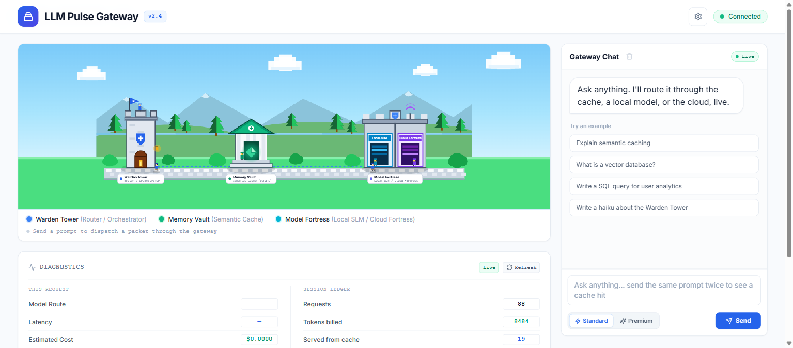

# LLM Pulse Gateway

[](#setup)


[](#the-whole-stack-from-compose)
[](#tests)

[](#license)

A local-first LLM routing gateway: one endpoint in, one answer out, with a semantic
cache, a local small language model, and a cloud fallback chain that only spends the
key it was explicitly given. A pixel-canvas visualiser shows each hop live.

Everything runs on your machine by default. With no API keys and no Ollama, the
gateway still answers: it labels the reply `status: "simulated"` rather than
pretending a model replied.



---

## What it does, in plain words

Imagine the front desk of a hotel. Every request is logged, the desk remembers questions it has
already answered, cheap work is done in house, only the concierge with a signed card spends
money, and when nobody can help, the desk says so instead of inventing an answer.

That desk, for AI models. Six things a visitor can see it do:

1. **Ask the same question twice, pay once.** The second answer comes out of memory instead of
   a paid model. Proof: the ledger's `Served from cache` counter, in [Usage ledger](#usage-ledger).
2. **Ordinary questions never leave the computer.** They go to a model running on the same
   machine, so the cost is electricity. Proof: `destination: "local_slm"` and `cost_usd: 0.0` in
   [Response provenance](#response-provenance).
3. **Hand it a document and ask about it.** It finds the relevant page and answers from it, and
   by default that page is only ever shown to the local model. Proof: `rag_used: true` in
   [Local knowledge base (RAG)](#local-knowledge-base-rag).
4. **It cannot spend the wrong person's money.** A visitor can bring their own account key, and
   every answer records whose key paid. Proof: [Bring your own key (BYOK)](#bring-your-own-key-byok).
5. **It admits failure.** When no model answered, the reply is labelled `simulated` rather than
   made up. Proof: the same provenance block.
6. **You can watch the decision happen.** The screenshot above is a live diagram: every request
   walks visibly through the guard, the memory, and the model that answered.

The sections below are for the engineer on the other side of the interview: exact endpoints,
settings, measured numbers, and the limits this project does not pretend to have solved.

---

## What problem it actually solves

| Situation | What happens | What you pay |
|---|---|---|
| Prompt already asked (semantically) | served from the vector cache | 0 model tokens |
| Simple / short prompt | local Ollama model | nothing (your GPU) |
| Question about a stored document | local model, prompted with the retrieved chunks | nothing, and the document never leaves the machine |
| Complex prompt or `premium` tier | cloud tier | whoever's key is used |
| Caller supplied `byok` | cloud tier bills **the caller**, not you | their quota |
| Nothing reachable | answer labelled `simulated` | nothing |

The ledger (`GET /api/gateway/usage`) is what makes those claims checkable instead of
aspirational; see [Measured behaviour](#measured-behaviour).

---

## Architecture

```
                        ┌──────────────────────── WebSocket /ws/signals
                        │                              (7 event types → pixel canvas)
   POST /api/gateway/chat
        │
        ▼
 ┌──────────────┐  hit   ┌───────────────────┐
 │ Warden Tower │───────▶│ Memory Vault      │  semantic cache: Ollama nomic-embed-text
 │  (router)    │        │ (vector cache)    │  cosine similarity ≥ 0.90
 └──────┬───────┘        └─────────┬─────────┘
        │ miss                     │ stored answer (0 tokens, 0 cost)
        ▼                          │
 ┌──────────────┐                  │
 │ SmartRouter  │  heuristics: prompt length, keywords, tier
 │ (route+cost) │──────────────────┐
 └──────┬───────┘                  │
        │ local                    │ cloud
        ▼                          ▼
 ┌──────────────┐
 │ Knowledge    │  top-2 chunks, cosine ≥ 0.35
 │ Base (RAG)   │  private documents: local routes only
 └──────┬───────┘  unless RAG_ALLOW_CLOUD
        ▼
 ┌──────────────┐        ┌────────────────────────────────────┐
 │ Model        │        │ Provider cascade                   │
 │ Fortress     │        │ 1. Ollama /api/chat (local, capped)│
 │              │        │ 2. Gemini  (direct HTTP)           │
 │              │        │ 3. DeepSeek (direct HTTP)          │
 │              │        │ 4. LiteLLM: OpenAI → Anthropic →   │
 │              │        │    Groq → xAI → OpenRouter         │
 │              │        │ 5. labelled stand-in ("simulated") │
 └──────┬───────┘        └──────────────────┬─────────────────┘
        │                                   │
        └────────────┬──────────────────────┘
                     ▼
          ┌────────────────────┐     ┌──────────────────────┐
          │ Evaluation engine  │────▶│ Usage ledger (SQLite)│
          │ non_empty          │     │ append-only rows     │
          │ real_model_answered│     └──────────────────────┘
          └────────────────────┘
```

Storage: **Qdrant** for the vector indexes when reachable (two collections,
`semantic_cache` and `knowledge_base`); otherwise the same cosine index runs in-process
and writes itself to `CACHE_FILE_PATH` (`data/semantic_cache.json`) and
`KNOWLEDGE_FILE_PATH` (`data/knowledge_base.json`) on every save, so cached answers and
stored documents survive a restart without Docker. `QDRANT_HOST` defaults to `127.0.0.1`,
not `localhost`: compose publishes IPv4 only, and on Windows `localhost` resolves to
`::1` first, which reads as a connection refused.

---

## Request lifecycle

`backend/app/api/gateway.py` runs six steps, broadcasting a `SignalPacket` between each:

1. `CACHE_MISS` / `CACHE_HIT`: semantic lookup
2. `ROUTING_SIGNAL`: chosen destination, model, estimated cost, reason, and the
   complexity breakdown (score, word count, heuristic hits) behind that reason
3. knowledge retrieval: the closest chunks from the local knowledge base, if any
   apply to this route (see [Local knowledge base](#local-knowledge-base-rag))
4. `MODEL_EXECUTION`: cascade attempt
5. `EVALUATION`: pass/fail on the two observable checks
6. `COMPLETION`: latency, model, tokens, status, `truncated`

Every step is also returned inline in the response `signals` array, so a client can
replay a request's path without subscribing to the socket. `POST /api/gateway/chat/stream`
runs the same lifecycle and delivers it as Server-Sent Events instead of one block.

---

## Gates: access token and rate limit

Both are open by default, because a local demo should not need a token to start. Set
them in `.env` before the port means anything.

| Setting | Effect |
|---|---|
| `GATEWAY_TOKEN` | every route then demands `Authorization: Bearer <token>`; `/ws/signals` carries it as `?token=<token>` because a browser socket cannot set a header |
| `RATE_LIMIT_PER_MINUTE` | per-client sliding window; over it returns `429` with a `retry-after` header. `0` disables |

Order matters and is deliberate: an unauthenticated request is refused with `401`
before the limiter counts it, so guessing a token cannot consume a caller's window.
The UI says which refusal happened ("The gateway needs its access token…" vs "Too many
requests…") and keeps the token in `localStorage` next to the BYOK keys.

Bind to `127.0.0.1` until you have set a token. Without one, anyone who can reach the
port spends the keys in your `.env`.

---

## Conversation memory

`GatewayRequest.history` carries prior turns (`{role: "user" \| "assistant", content}`),
so a follow-up like "and in one word?" is answerable. The last `MAX_HISTORY_TURNS` (12)
turns are forwarded between the system instruction and the new prompt.

While a conversation is in progress the semantic cache is **bypassed in both
directions**: it stores answers to standalone prompts, and replaying one for a
context-dependent follow-up would be wrong. A turn in progress is therefore never
written to it either.

---

## Streaming

`POST /api/gateway/chat/stream` answers with `text/event-stream` frames:

```
event: signal   # CACHE_MISS / ROUTING_SIGNAL / MODEL_EXECUTION / EVALUATION / COMPLETION
event: delta    # {"text": "..."} per piece, as the model writes it
event: done     # the whole StructuredPulseResponse, same fields as the block route
event: error    # {"detail": "..."} if the gateway stops mid-answer
```

The local tier streams from Ollama's native `stream: true`, so the first piece arrives
while the rest is still being generated. A cached answer is one `delta` plus `done`.
Cloud tiers are currently delivered as one piece; see [Known limits](#known-limits).

The ledger and the cache see the *finished* answer: one row per request, one entry per
complete reply, and a stream cut off by the token budget is flagged and never cached.

---

## Response provenance

`StructuredPulseResponse` never hides where an answer came from:

```json
{
  "response": "...",
  "destination": "local_slm",
  "model": "ollama/gemma4:e2b",
  "provider_used": "local_slm",
  "status": "success",
  "cache_hit": false,
  "tokens_used": 281,
  "latency_ms": 12369.28,
  "cost_usd": 0.0,
  "key_source": null,
  "truncated": true,
  "rag_used": true,
  "rag_chunks": 2,
  "signals": [ ... ]
}
```

`status` is one of `success`, `cached`, `fallback`, `simulated`, and `attempted`
inside `metadata` records every tier the cascade tried and why each one did not
answer (`skipped: no Gemini key (BYOK or .env)`, `HTTP 401`, `TimeoutException`, ...).
`rag_used` and `rag_chunks` say whether the answer was grounded in the local
knowledge base and how many chunks were retrieved.

**`key_source` says whose credential the tier that answered used**: `"byok"` when the
caller's request body carried the key, `"operator"` when the host's `.env`/environment
key did, and `null` when no cloud credential was involved (local Ollama, cache hit,
stand-in). The UI labels an answer "Your key" or "Host key" from exactly this field.

**`cost_usd` is the router's own estimate**, not an invoice: it comes from the route
decision and is `0.0` for local, cached, and simulated answers. Tokens are the real
counts reported by each provider.

---

## Bring your own key (BYOK)

Cloud calls are billed to the key that unlocked them.

```bash
curl -X POST http://localhost:8000/api/gateway/chat \
  -H "Content-Type: application/json" \
  -d '{
        "prompt": "Summarize this quarter's metrics",
        "tier": "premium",
        "byok": { "gemini_api_key": "...", "openai_api_key": "..." }
      }'
```

Rules, enforced in `app/core/credentials.py` and `app/core/providers.py`:

- Keys travel in the **request body**, not the `Authorization` header: no CORS
  preflight and no key in access logs.
- **Resolution order:** request `byok` → operator `.env` → process environment.
- Supported per-request fields: `gemini_api_key`, `deepseek_api_key`,
  `openai_api_key`, `anthropic_api_key`, `groq_api_key`, `xai_api_key`,
  `openrouter_api_key`.
- `metadata.key_source` reports `byok` or `operator` for the tier that answered.
- A key never comes back out. It is absent from the response, from every WS signal,
  from cache entries, and from ledger rows. Providers paste the offending key into
  their own error bodies, so anything that reaches a log is passed through
  `_redact()` first.
- The UI stores keys in `localStorage` only, behind masked inputs, with a Clear
  button. They stay on that machine and are readable by anyone with that browser
  profile. That is stated in the panel, not glossed over.

---

## Usage ledger

`data/usage.sqlite` (gitignored, standard library `sqlite3`, no server, no
dependency). Append-only `usage_events`, one row per request served:

`ts, route, model, status, cache_hit, tokens_used, latency_ms, estimated_cost_usd, key_source`

`GET /api/gateway/usage` aggregates **only what was measured**:

```json
{
  "requests": 4,
  "tokens_used": 580,
  "cache_hits": 1,
  "avg_latency_ms": 21267.98,
  "estimated_cost_usd": 0.0,
  "by_route": {
    "local_slm":    { "requests": 3, "tokens_used": 580, "estimated_cost_usd": 0.0 },
    "memory_vault": { "requests": 1, "tokens_used": 0,   "estimated_cost_usd": 0.0 }
  }
}
```

No prompt text and no key material is ever written. Delete the file to reset.

---

## Answer shape, token budget and truncation

Ollama allocates a KV cache sized by `num_ctx` and generates until the model stops,
which is how a "quick" local answer turns into a 1500-token markdown essay. The gateway
asks for the shape it wants with one system instruction (`ANSWER_STYLE` in
`backend/app/api/gateway.py`): plain prose, no markdown or em dashes, roughly 120 words.
Budgets:

| Setting | Value | Why |
|---|---|---|
| `OLLAMA_NUM_CTX` | 4096 | prompt + answer window; Ollama otherwise reserves the model's full 131k |
| `OLLAMA_NUM_PREDICT` | 256 | bounds generated tokens per answer (~110 words of prose) |
| `think` | `false` (payload) | reasoning models otherwise burn the whole budget on hidden chain-of-thought |
| `OLLAMA_KEEP_ALIVE` | `30m` | a cold reload costs 12–50 s |
| `INFERENCE_TIMEOUT_SECONDS` | 90 | must exceed cold-load + first token |

So a local answer is bounded by 4096 tokens of context with at most 256 generated: a
long pasted file plus a long essay will not fit, and the style instruction exists to
keep the answer inside the 256 instead of cutting it off.

When a reply hits the budget, Ollama reports `done_reason: "length"`, the response
carries **`truncated: true`**, and the answer is **not written to the cache**: a
cut-off reply must never be replayed as if it were complete. A `simulated` stand-in
is not cached either: it is generated from the prompt by code, not answered by a model.

---

## Cache lifetime and clearing

Each entry stores the `stored_at` it was written at. `CACHE_TTL_SECONDS` (default 86400)
turns a lookup on an older entry into a miss, so the model is re-asked rather than the
answer being replayed forever; `0` means entries never expire. A stale entry is still
keyed by its prompt, so the next answer to that prompt overwrites it.

To wipe the cache without deleting files by hand:

```bash
curl -X POST http://localhost:8000/api/gateway/cache/clear
# { "status": "cleared", "cache_backend": "qdrant:semantic_cache" }
# or, on the fallback index: { "status": "cleared", "cache_backend": "in-memory(7 entries)" }
```

It answers with which backend was cleared, and is behind the same token gate as the
rest of the API.

---

## Local knowledge base (RAG)

Paste a document and the gateway chunks it, embeds it, and stores it in its own index.
On later questions it retrieves the closest chunks and puts them in front of the prompt,
so a 2B local model answers from the handbook instead of from its weights.

```bash
curl -X POST http://localhost:8000/api/gateway/documents \
  -H "Content-Type: application/json" \
  -d '{ "text": "The pulse handbook secret codeword is aurora-7.", "source": "handbook" }'
# { "status": "stored", "chunks_stored": 1, "knowledge_backend": "qdrant:knowledge_base" }

curl -X POST http://localhost:8000/api/gateway/chat \
  -H "Content-Type: application/json" \
  -d '{ "prompt": "what is the secret codeword in the pulse handbook" }'
# "destination": "local_slm", "rag_used": true, "rag_chunks": 1, ...
```

| Setting | Default | Effect |
|---|---|---|
| `KNOWLEDGE_CHUNK_WORDS` | 120 | words per chunk; paragraph boundaries first, then a hard split |
| `RAG_TOP_K` | 2 | chunks attached per question |
| `RAG_MIN_SIMILARITY` | 0.35 | loose on purpose: a question rarely embeds close to its answer paragraph |
| `RAG_ALLOW_CLOUD` | `false` | the only way retrieved text may leave the machine |

Storage and the embedder are the cache's: `knowledge_base` collection in Qdrant when it
answers, `data/knowledge_base.json` when it does not, and `nomic-embed-text` for the
vectors. No new dependency and no second model. Re-adding the same `source` and chunk
text updates that point instead of duplicating it. In the UI the paperclip under the chat
box adds a text or markdown file in one click: the browser reads the file and posts its
text to the same route, so there is no upload endpoint and no parser to install. The
manual paste box, the Clear button and the "Grounded in N doc chunks" chip sit next to it.

**The privacy gate.** Retrieved chunks are the caller's own documents, so they ride local
routes only, and the gate is enforced twice on purpose:

- at route time: a prompt the router sends to a cloud tier retrieves nothing and is
  forwarded as the plain question, so "premium" never quietly uploads a handbook
- at execution time: a local route that cannot answer (Ollama down, model out of memory)
  is refused its cloud fallback and gets the labelled `simulated` stand-in instead. The
  first gate cannot see an outage; only the second one can.

Set `RAG_ALLOW_CLOUD=true` to opt in to cloud grounding.

An empty store never reaches the embedder (`count() == 0` short-circuits retrieval), so a
gateway with no documents behaves exactly the way it did before this feature existed.

---

## Setup

Requirements: Python 3.11+, Node 18+, and optionally Docker and Ollama.

```bash
pip install -r requirements.txt
cp .env.example .env                      # fill in nothing to stay local

# Optional infrastructure (vector persistence; cache works without it).
# Needs the Docker engine running, not just the CLI installed.
docker-compose up -d qdrant

# Local model
ollama serve &                            # or the desktop app
ollama pull gemma4:e2b                    # any chat model
ollama pull nomic-embed-text              # embeddings for the semantic cache

# Backend  -> http://localhost:8000  (docs at /docs)
python -m uvicorn backend.main:app --reload --port 8000 --host 127.0.0.1

# Frontend -> port from frontend/package.json
cd frontend && npm install && npm run dev
```

### The whole stack from compose

The same backend also ships as a container, so the full topology (gateway, Qdrant,
TLS proxy, metrics scraper) comes up as one unit. The operator's native `:8000`
process is untouched; the containerized copy listens on loopback only:

```bash
docker compose up -d            # qdrant + gateway(:8010) + caddy(:8443) + prometheus(:9090)
GW=http://127.0.0.1:8010 ./scripts/demo.sh
```

Inside the container Ollama is reached at `host.docker.internal:11434`, because the
model belongs to the host GPU; dockerizing the model itself would give up the GPU for
no gain. Caddy terminates TLS with a self-signed internal certificate, so:

```bash
curl -sk https://localhost:8443/health        # through TLS, with security headers
curl -s  http://127.0.0.1:8010/health         # direct, for comparison
curl -s  http://127.0.0.1:9090/api/v1/targets # Prometheus shows the gateway target UP
```

Measured on the compose stack: the first prompt through `:8010` answered `local_slm`
in 2.6 s with 201 tokens, the repeat hit the Qdrant cache in 87 ms with 0 tokens,
`/api/gateway/metrics` reported `gateway_requests_total`/`gateway_tokens_used_total`/
`gateway_cache_hits_total` straight from the ledger, and Prometheus showed the
`gateway` target `up` on `/api/gateway/metrics`. The Caddy site is `localhost:8443`
because `tls internal` needs a hostname to issue the certificate for; loopback-only
publishing is unchanged.

Cloud tiers are opt-in per key: set `GEMINI_API_KEY`, `DEEPSEEK_API_KEY`,
`OPENAI_API_KEY`, `ANTHROPIC_API_KEY`, `GROQ_API_KEY`, `XAI_API_KEY` or
`OPENROUTER_API_KEY` in `.env`, or pass `byok` per request. `host_provider_status()`
exposes which providers the host can already reach, as booleans, never key material
(`GET /api/gateway/models`).

`GATEWAY_TOKEN` and `RATE_LIMIT_PER_MINUTE` are both unset in a fresh `.env`, which
leaves the gateway open on `127.0.0.1`; see [Gates](#gates-access-token-and-rate-limit)
before exposing it further.

## Tests

```bash
python -m pytest
```

The suite is hermetic by construction (`tests/conftest.py`): every cloud credential
variable is unset, the LiteLLM tier is forced unavailable, the ledger and the fallback
cache and knowledge files are pointed at a temporary directory, the cache and knowledge
services are replaced with in-process indexes so no test touches a live Ollama or Qdrant,
and the gates are opened so no test needs a token. 94 tests, no network calls.

## Endpoints

| Method | Path | Purpose |
|---|---|---|
| `POST` | `/api/gateway/chat` | route, answer, cache, and return provenance |
| `POST` | `/api/gateway/chat/stream` | the same lifecycle as SSE (`signal` / `delta` / `done` / `error`) |
| `GET` | `/api/gateway/usage` | ledger aggregates |
| `GET` | `/api/gateway/models` | local models pulled + per-provider host key status |
| `GET` | `/api/gateway/metrics` | the ledger as Prometheus gauges (scraped by the compose stack) |
| `POST` | `/api/gateway/cache/clear` | drop every cached answer |
| `POST` | `/api/gateway/documents` | chunk, embed and store a document in the knowledge base |
| `POST` | `/api/gateway/documents/clear` | drop every stored document chunk |
| `WS` | `/ws/signals` | live routing events for the canvas |
| `GET` | `/health` | liveness |

## The models behind it

Nothing here is a mock: these are the actual model names this gateway was run against, with the
role each one played. Sizes are what the local Ollama daemon reported on the machine this was
built on (an RTX 4050 laptop, 6 GB VRAM).

| Model | Where it runs | Size | Job in this gateway |
|---|---|---|---|
| `gemma4:e2b` | Ollama, local | 7.16 GB | the configured default answerer (`OLLAMA_MODEL` in `backend/config.py`). It answered on this machine while it stayed resident, and those are the `gemma4:e2b` rows in [Measured behaviour](#measured-behaviour). It is a 7 GB model on a 6 GB card, so the more recent runs here name the next row instead |
| `gemma2:2b` | Ollama, local | 1.63 GB | the local model in the screenshot and in most measurements: answered a grounded handbook question with 303 tokens in 18.79 s at `cost_usd: 0.0` |
| `nomic-embed-text` | Ollama, local | 0.27 GB | the semantic model. One embedder serves both the cache and the knowledge base, 768 dimensions per vector, so a document and a prompt are comparable in the same space |
| `deepseek-chat` | LiteLLM, cloud | provider hosted | the premium tier that actually answered a paid request: 213 tokens, \$0.006, 32.3 s, `key_source: operator` |
| `gemini-3.8-flash`, `gpt-4o-mini`, `claude-3-5-sonnet-20241022`, `llama-3.3-70b-versatile`, `grok-2-latest`, `openai/gpt-4o-mini` | LiteLLM, cloud | provider hosted | the rest of the cascade, one default per provider in `backend/config.py`. A tier with no key is skipped outright and the reason lands in `attempted`, so the list is a capability, not a bill |
| `qwen3.5:4b`, `minimax-m2.5:cloud` | Ollama, on disk | 3.39 GB, stub | present but not wired in. `qwen3.5:4b` loads at 7.5 GB and 100 percent CPU on this machine and took 110 s or more for a one line prompt, so nothing routes to it |

**What the local side was doing, in numbers.** In the session behind the screenshot the ledger held
103 requests: 76 answered by the local model (10,888 tokens), 24 served straight from the vector
cache (0 tokens), and 3 rows on the cloud tier carrying 0 billed tokens, for \$0.0000 estimated
cost across the whole session. The paid cloud answer in the table above is a separate measured
run, on the containerized gateway.

**Swapping in a newer model is a config line, not a code change.** `OLLAMA_MODEL`,
`EMBEDDING_MODEL` and one `DEFAULT_<PROVIDER>_MODEL` per provider are read from `.env`, so a
fresher release is picked up without touching the cascade, the cache or the UI.

**What it is wired to:** FastAPI 0.115 with Pydantic 2.13 typed contracts, `uvicorn` 0.34,
LiteLLM 1.98 as the cloud cascade, `qdrant-client` 1.19 for both vector indexes, Next.js 14 with
React 18 and Tailwind 3.4 on the front, Caddy for TLS termination, and Prometheus for scraping.

## Measured behaviour

Same prompt (`"Explain semantic caching, vector databases, and LLM routing in detail
with examples."`), model `gemma4:e2b`, warm process:

| Path | Generated tokens | Wall clock |
|---|---|---|
| Ollama direct, uncapped | 1513 (`done_reason: stop`) | 28.0 s |
| Through the gateway, capped at 256 | 281 total incl. prompt, `truncated: true` | 12.4 s |
| Second identical prompt, cache hit | 0 | 2.1 s |
| Capped **and** style-instructed (current) | 189 total incl. prompt, `truncated: false` | 12.5 s |

The last row is today's behaviour, measured on `"how to understand any new language"`:
108 words of plain prose that finishes inside the budget, so the cap no longer cuts the
answer off; the instruction makes the answer small enough to fit.

The capped request additionally pays routing and embedding overhead inside that
12.4 s, so the comparison is conservative. A cold first request in a fresh process
cost 55.9 s and a short one-shot answer cost 14.7 s: model load dominates the first
call, which is why `keep_alive` is raised to 30m.

Streaming, same machine, model already warm (`gemma4:e2b`):

| Prompt | Pieces | First piece | Whole answer | Tokens |
|---|---|---|---|---|
| "What is a knowledge graph?" | 163 | 3.7 s | 6.4 s | 232 |
| "What is prompt injection?" | 132 | 7.4 s | 9.5 s | 200 |

The reader sees the answer while it is still being generated, which is the whole point:
the block route made them wait the full 6–10 s for one blob. A cold process is the
opposite story: the first token waited 41.8 s because loading the model into VRAM
comes before it, and `keep_alive=30m` is what keeps that out of the way.

Cache lifetime, measured with `CACHE_TTL_SECONDS=4`:

| Step | Result |
|---|---|
| first ask | `success`, 218 tokens, 12.5 s |
| same prompt immediately | `cached`, 0 tokens, 2.2 s |
| same prompt 5 s later | `success` again; the entry expired and the model was re-asked |
| after `POST /api/gateway/cache/clear` | `success`, 232 tokens |

Restart durability: three prompts in `data/semantic_cache.json`, process killed, started
again, first repeat answered `cached` with 0 tokens (6.4 s, because the embedder model
itself had to reload).

With Qdrant actually running (`docker compose up -d qdrant`), the same promise is held by
the server instead of the file: a prompt was stored as one 768-dim point, then the
container was restarted, then the whole Docker engine was stopped and brought back, and
the point was still there both times. A backend restart on top of that answered the same
prompt `cached` with 0 tokens in 2.4 s, and `POST /api/gateway/cache/clear` reported
`qdrant:semantic_cache` and left the collection gone until the next stored answer.
Whichever backend is live is the one the response tells you about.

RAG grounding, measured on the local tier (`gemma2:2b`, Qdrant running). One document
stored: `"The pulse handbook secret codeword is aurora-7."`. A question that document
cannot answer from its own weights, `"what is the secret codeword in the pulse handbook"`,
came back `status: "success"`, `rag_used: true`, `rag_chunks: 1`, `destination:
"local_slm"`, 247 tokens, 0 cost, with the answer quoting **aurora-7**. Removing the
privacy gate's guard while Ollama was out of memory had sent that same retrieved chunk to
the cloud fallback, which is the bug the execution-level gate exists to prevent.

Gates, measured on a second process with `GATEWAY_TOKEN` and `RATE_LIMIT_PER_MINUTE=3`:
no header `401`, wrong scheme `401`, exact bearer `200`, fourth call in the minute
`429` with `retry-after: 59.0`.

Follow-up with `history`, local tier: "And in one word?" over a previous answer about
embedding models returned `Representation` in 1.58 s: the earlier turns reached the
model, and the exchange was not served from, or written to, the cache.

## Known limits

Stated rather than hidden:

- **One shared token, not accounts.** `GATEWAY_TOKEN` is a single bearer secret: it says
  "this caller is allowed", not who they are. There are no users, sessions, or per-key
  quotas, and the rate-limit window is per client address in process memory, so it
  resets on restart and every caller looks like one client behind a proxy.
- **Streaming is the local tier.** Cloud tiers answer as one `delta`; their APIs need
  per-provider `astream` calls, which is worth doing when a cloud route becomes the
  usual one, not while local answers the simple prompts.
- **Conversation memory is per request.** The server stores no session: the client sends
  `history` with each call and the last 12 turns are forwarded. Close the tab and the
  conversation is gone.
- **Expiry is a read rule.** An entry past `CACHE_TTL_SECONDS` is treated as a miss and
  overwritten by the next answer; nothing is deleted from Qdrant on a timer.
- **The fallback cache file is rewritten whole on every save.** Fine for a few thousand
  entries, wrong for more: run Qdrant when it matters.
- **The two backends do not merge.** The index is chosen once per process, from whether
  Qdrant answers on `QDRANT_HOST:QDRANT_PORT` at the first cache use. Answers stored in
  the file while Docker was off stay invisible to Qdrant, and vice versa, so a stopped
  Docker Desktop reads as a wave of cache misses rather than an error. Restart the
  backend after starting Qdrant; the running process keeps whichever index it picked.
- **Local answers are short by design**: 4096 tokens of context total (prompt included)
  and at most 256 generated, which is about 110 words of prose. Paste a large file and
  ask about it and it will not fit; that route needs a cloud key. A multi-turn
  conversation pays for its own history inside that same window.
- **Cost is an estimate** (router-side), tokens are real (provider-reported).
  `estimated_cost_usd` for local and simulated routes is `0.0` because nothing was
  billed, not because a price was computed.
- **RAG is one-hop retrieval, no reranking.** The top 2 chunks above a loose 0.35
  similarity are pasted in as-is: a question that needs three separate paragraphs, or a
  chunk whose answer is worded very differently from the stored text, can miss. A model
  ranked reranker is the upgrade, and it costs a second loaded model.
- **A grounded answer is cached under the raw prompt.** The cache does not know the
  knowledge base existed, so editing or clearing documents does not invalidate answers
  they produced: run `POST /api/gateway/cache/clear` after changing the store.
- The UI's **"Your key" chip only appears when the caller's own key answered**, which
  needs a key pasted under API keys & settings. Without one, an answer is honest about
  being routed locally or on the host key.

## Future work

Deferred on purpose, each with the thing that makes it worth building:

- **Tool calls, not only text.** The cascade can answer but never act. Function calling
  (read the ledger, run a bounded SQL, hit an internal API) is what turns "ask about the
  handbook" into "do the thing the handbook says", and it needs the response schema to
  carry a tool result next to `response`. This is the biggest remaining gap.
- **OCR and document parsers.** The paperclip takes text files because the browser reads
  those with no dependency. PDF, DOCX and scanned pages need a server-side extractor,
  plus a decision about where extracted text is allowed to go, so it stays out of the
  request path until someone actually needs it.
- **Server-side sessions.** `history` travels with every request today, which is why the
  semantic cache has to bypass a conversation in progress. A stored session would let the
  cache serve follow-ups too.
- **Accounts instead of one shared token.** Per-caller identity and per-key quotas; see
  the first Known limit for what the single bearer secret does and does not buy.
- The rest of the honest gaps are already listed above: cloud-tier streaming, the
  file/Qdrant indexes never merging, and expiry being a read rule.

## The vocabulary, and where each word actually lives

Job descriptions for AI platform and LLM platform roles repeat a predictable set of terms. Here
is that vocabulary with the file or section that implements it, so nothing in this list is a
claim that cannot be opened and checked.

| Job description term | Where it is in this repo |
|---|---|
| LLM gateway, AI gateway | the service itself: one `/api/gateway/chat` in front of several model backends, `backend/app/api/gateway.py` |
| Model routing, fallback chain, failover | tier heuristics and the cascade that walks them, `backend/app/core/router.py`, `backend/app/core/providers.py` |
| Cost attribution, token accounting | SQLite ledger of provider-reported tokens and cost per request, keyed by whose key paid, `backend/app/core/usage.py` |
| BYOK, credential isolation, secret handling | per-request caller keys that stay out of responses, logs, metrics and storage, `backend/app/core/credentials.py` |
| Semantic caching, vector database, embeddings | cosine cache on Qdrant with a file-backed fallback, `backend/app/core/cache.py` |
| RAG, chunking, retrieval, grounding | chunk, embed, retrieve, cite, `backend/app/core/knowledge.py` and [Local knowledge base (RAG)](#local-knowledge-base-rag) |
| Guardrails, data policy, redaction | the two-level privacy gate plus prompt redaction, `backend/app/api/gateway.py`, `backend/app/core/providers.py` |
| Observability, metrics, provenance | Prometheus exposition at `/api/gateway/metrics`, live WebSocket signal feed, per-request provenance fields, `prometheus.yml`, `backend/app/api/websocket.py` |
| Evaluation, quality gating | pass/fail screen on the failures this gateway can observe, `backend/app/features/evals.py`. It reports no faithfulness score, because there is no ground truth to score against |
| Streaming, SSE, time to first token | token-by-token from the local tier, `/api/gateway/chat/stream` |
| API design, typed contracts | FastAPI with strict Pydantic v2 models, OpenAPI at `/docs`, `backend/app/features/parser.py` |
| Authentication, rate limiting | bearer token plus a sliding window per client, `backend/app/core/guard.py` |
| TLS termination, reverse proxy | `Caddyfile` in the compose stack |
| Containerisation, reproducible config | `Dockerfile`, `docker-compose.yml`, `.env.example` |
| Testing, TDD, CI-ready suite | 95 hermetic tests that need no network, `tests/`, [Tests](#tests) |
| Developer experience | one scripted demo end to end (`scripts/demo.sh`), live UI, [Setup](#setup) |

Deliberately not claimed, because they are not in this repo: LLM-as-judge eval suites, prompt
registries and versioning, Kubernetes, Helm or Terraform, GPU serving stacks such as vLLM,
fine-tuning, multi-tenant accounts, and distributed tracing across services.

## Layout

```
backend/
  config.py                  pydantic-settings; all knobs come from .env
  main.py                    app, CORS, routers, /health
  app/
    api/gateway.py           the 6-step request pipeline, block + streaming routes
    api/websocket.py         SignalPacket broadcast (/ws/signals)
    core/guard.py            bearer token + per-client rate window
    core/router.py           SmartRouter heuristics + cost estimate
    core/providers.py        cascade, BYOK resolution, redaction, provenance
    core/cache.py            semantic cache: Qdrant, or a file-backed local index
    core/knowledge.py        RAG store: chunking, embedding, retrieval
    core/credentials.py      BYOKCredentials
    core/usage.py            SQLite ledger
    features/parser.py       request/response models
    features/evals.py        observable answer checks
frontend/
  src/pages/index.jsx        chat (streaming), metrics, BYOK + access-token panel, ledger
  src/components/pulse/      Canvas 2D pixel world driven by WS signals
  src/lib/pulse/gateway.js   endpoints, SSE parsing, and formatting single source
tests/                       hermetic suite (see conftest.py)
scripts/demo.sh              the five-minute proof: miss, hit, grounded doc, cloud route, ledger
scripts/blender/             sprite/asset generators for the canvas
Dockerfile                   the backend as a container (compose: gateway)
docker-compose.yml           qdrant, gateway(:8010), caddy TLS(:8443), prometheus(:9090)
Caddyfile                    TLS termination + security headers for the compose stack
prometheus.yml               scrape config pointed at /api/gateway/metrics
```

---

## License

MIT. See [LICENSE](LICENSE).
